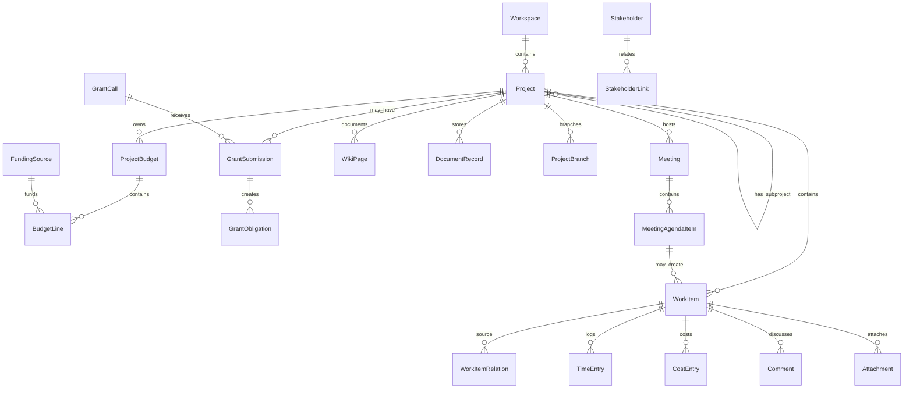

# LibrePM_PRD.md

## Revisione operativa — 2026-10-16

Questa revisione prevale sui punti incompatibili delle sezioni precedenti. La direzione è un prodotto desktop premium, locale per impostazione predefinita, con backend condiviso opzionale MariaDB. Il termine “certificato” indica esclusivamente un requisito con evidenza riproducibile nel rapporto qualità, non l'intero prodotto.

| ID | Requisito verificabile | Accettazione / evidenza |
| --- | --- | --- |
| UI-01 | Identità coerente con logo | Blu `#1a62a2`, teal `#1a919a`, superfici e controlli condivisi in `premium.css`; screenshot browser |
| UI-02 | Navigazione completa | Tutte le pagine, incluse Gantt, Risorse e Impostazioni, accessibili anche nel profilo personale |
| UI-03 | Recupero errori | Errore render locale mostra pannello e Riprova; navigazione resta disponibile |
| UI-04 | Uso tastiera e preferenze | Focus visibile, nome accessibile per navigazione, `aria-current`, movimento ridotto; audit WCAG completo ancora necessario |
| GANTT-01 | Portabilità renderer | Asset locali nella build, barre visibili, cambi Day/Week/Month, visita ripetuta senza DOM duplicato |
| GANTT-02 | Sicurezza contenuti | Titoli e stati nel popup trattati come testo, senza eseguire markup utente |
| MSG-01 | Conversazioni progetto persistenti | GET/POST `/api/users/{userId}/projects/{projectId}/messages`; UI con invio e ricaricamento |
| MSG-02 | Validazione | Testo non vuoto, massimo 4000 caratteri; HTTP 400 per input invalido |
| MSG-03 | Permessi | OWNER/ADMIN/EDITOR scrivono, VIEWER legge, estranei ricevono 403; autore assegnato dal backend |
| MSG-04 | Carico limitato | Feed ordinato per data/id, 50 messaggi per pagina, polling 10 secondi e aggiornamento esplicito |
| DB-01 | MariaDB remota | Provisioning amministrativo esplicito, rifiuto database non vuoto, schema da migrazioni, test server MariaDB reale |
| DB-02 | Separazione credenziali | JDBC solo backend; renderer usa URL API HTTPS configurato in build |
| SEC-01 | Identità sessione | Con autenticazione attiva, URL/header non possono impersonare identità diversa dal principal |
| OPS-01 | Isolamento dati | `LIBREPM_DATA_PATH` o system property rispettati all'avvio |
| QA-01 | Evidenze di rilascio | Suite Java + browser contro build distribuita e backend reale + test packaging; esiti in `QUALITY_REPORT.md` |

### Vincoli di distribuzione e qualità

- Multiutenza pubblica subordinata a test IdP reale, CSRF/CORS, isolamento completo, TLS, backup/ripristino e aggiornamenti schema MariaDB già popolati.
- Messaggi iniziali non includono WebSocket, allegati, ricevute o modifica/cancellazione. Non dichiarare tali capacità disponibili.
- Copertura di navigazione non equivale a copertura CRUD di ogni modulo; mappare separatamente smoke test, integrazione e E2E.
- Installatori Windows/macOS, audit WCAG e test di carico non sono certificati da esecuzione Linux.
- Nessuna garanzia “zero bug” o “nessuna regressione” senza limiti: mantenere gate e difetti aperti nel rapporto.

Documenti operativi: `reconstruction_ui.md`, `deploy/README.md`, `QUALITY_REPORT.md`.


**Prodotto:** LibrePM — European Project Governance Platform  
**Versione documento:** 3.0 evolutiva OpenProject-aware  
**Data:** 2026-05-18  
**Destinatari:** Product Owner, Scrum Master, junior developer, QA, UX/UI, architetti, security, compliance  
**Output atteso:** specifica evolutiva completa per trasformare LibrePM in una piattaforma europea competitiva di project governance, senza snaturarne natura privacy-first, local-first ed EU-oriented.

---

## 1. Executive summary

LibrePM deve diventare una piattaforma europea di project governance capace di competere con prodotti maturi come OpenProject sul piano funzionale, superandoli però su tre assi distintivi:

1. **Local-first reale:** il workspace locale è la fonte primaria del dato. Cloud, sync, API esterne e integrazioni sono capability opzionali, esplicite e revocabili.
2. **Privacy-first reale:** niente telemetria di terze parti per default, niente tracker, niente behavioral analytics occulte, niente people surveillance.
3. **EU-oriented reale:** template e workflow pensati per bandi, grant, stakeholder, sponsor, rendicontazione, PM²/PMflex, accessibilità, data portability, auditabilità e procurement europeo.

OpenProject dimostra la maturità attesa dal mercato: work packages, Gantt, boards, backlogs, time/cost, budgets, meetings, wiki, repository, integrations, permissions, API e amministrazione. LibrePM deve implementare la stessa ampiezza funzionale, ma reinterpretandola in un modello più moderno, locale, modulare, etico e adatto al mercato europeo.

La strategia non è copiare OpenProject. La strategia è **assorbire la lezione di prodotto**: un sistema competitivo deve coprire tutto il ciclo di vita progettuale. LibrePM deve farlo con una grammatica propria: WorkItem universale, metamodel dichiarativo, project finance avanzato, grants governance, branch evolutivi e analytics etiche.

---

## 2. Posizionamento ufficiale

**Nome prodotto:** LibrePM  
**Categoria:** European Project Governance Platform  
**Descriptor:** Privacy-first, local-first governance for projects, finance, grants, stakeholders and evidence-based delivery.

### Cosa è LibrePM

LibrePM è una piattaforma europea di governance progettuale che unisce gestione operativa, pianificazione, knowledge base, collaborazione, finanza di progetto, gestione bandi, stakeholder governance, evolutive, branch, analytics e compliance readiness in un workspace locale e controllabile.

### Cosa non è LibrePM

- Non è un ERP.
- Non è una contabilità generale.
- Non è un PPM enterprise burocratico.
- Non è un sistema HR.
- Non è uno strumento di sorveglianza del lavoro.
- Non è un clone tecnico o visivo di OpenProject.

---

## 3. Differenza di stack tecnologico rispetto a OpenProject

### OpenProject osservato

OpenProject è una piattaforma web-based. Dal repository ufficiale emergono un backend Ruby/Rails, moduli applicativi separati, frontend TypeScript/Angular, API, plugin/integration layer, pacchetti on-premises e cloud.

### LibrePM target

LibrePM deve usare un'architettura coerente con desktop/local-first:

- **Desktop shell:** Electron.
- **Frontend:** React + TypeScript.
- **Backend locale:** Python FastAPI oppure servizio Python locale equivalente.
- **Database locale:** SQLite con SQLCipher o cifratura equivalente.
- **Indexing locale:** SQLite FTS5 o engine locale cifrabile.
- **Sync opzionale:** adapter separato, non core obbligatorio.
- **Packaging:** `.deb`, `.exe`, `.dmg`.
- **Metamodel/codegen:** YAML/JSON schemas → Pydantic → TypeScript → SQL migrations → form/renderers → tests.

### Conseguenza pratica

Ogni feature OpenProject deve essere reinterpretata come modulo local-first:

- niente assunzione di server sempre acceso;
- niente assunzione di utenti sempre online;
- niente storage cloud implicito;
- niente webhook inbound se l’utente non abilita API/network mode;
- niente moduli hardcoded quando è possibile usare metaprogrammazione dichiarativa.

---


## Fonti di benchmark consultate

Questa evolutiva usa OpenProject come benchmark funzionale, non come base tecnica da copiare. Le fonti principali consultate sono:

- Repository ufficiale `opf/openproject`, branch `dev`, README, struttura cartelle, moduli, Gemfile, package.json.
- Documentazione ufficiale OpenProject su ciclo di vita progetto, work packages, Gantt, boards, team planner, time/costs, budgets, meetings, wiki, repository, GitHub/GitLab integrations, API, notifiche, ruoli e permessi.
- Documentazione pubblica sulle edizioni Community/Enterprise e moduli on-premises/cloud.

Nota tecnica: LibrePM deve reimplementare le capability con stack e architettura propri. Non deve copiare codice, asset, UI proprietaria, naming interno o comportamenti coperti da licenze incompatibili. OpenProject è un benchmark di copertura funzionale e maturità di dominio.


## Analisi funzionale di OpenProject tradotta in evolutive LibrePM

### Lettura a 10 lenti

1. **Lente prodotto**: OpenProject copre quasi tutto il ciclo di vita di progetto, dalla creazione, pianificazione, esecuzione, controllo economico, collaborazione, chiusura e archiviazione. LibrePM deve coprire lo stesso ciclo, ma con un posizionamento più europeo, local-first e grant-aware.
2. **Lente dominio**: il concetto centrale di OpenProject è il work package. LibrePM deve avere un'entità equivalente più ampia, `WorkItem`, capace di rappresentare task, milestone, bug, rischio, deliverable, fase, change request, obbligo di bando, voce di budget, azione di meeting e issue tecnica.
3. **Lente scheduling**: OpenProject eccelle su Gantt, dipendenze, working days, modalità manuale/automatica, multi-project timeline. LibrePM deve raggiungere parità funzionale, ma con planner locale e merge semantico.
4. **Lente agile**: OpenProject ha boards, backlogs, sprint, viste per Kanban/Scrum. LibrePM deve integrarli senza trasformarsi in Jira; i board devono essere viste del dominio, non un dominio separato.
5. **Lente finanza**: OpenProject gestisce time, costs, unit costs, labor costs, budget e reporting. LibrePM deve superarlo con project finance, funding sources, eligibility, grants, sponsor e donations.
6. **Lente collaborazione**: OpenProject ha meeting, wiki, documenti, news, forum, notifiche, activity. LibrePM deve offrire collaborazione locale e sincronizzabile, ma senza telemetry, tracker, session replay o ranking occulto.
7. **Lente amministrazione**: OpenProject è forte su ruoli, permessi, workflow, custom fields, moduli attivabili. LibrePM deve rendere questi elementi dichiarativi e comprensibili da team junior tramite metamodel.
8. **Lente integrazioni**: OpenProject integra repository, GitHub/GitLab, file storage, API, SCIM, MCP, BCF. LibrePM deve offrire adapter opzionali e privacy-gated, non dipendenze obbligatorie dal cloud.
9. **Lente verticale europea**: OpenProject include riferimenti a PM², PMflex, PRINCE2, SAFe, BIM e settori pubblici. LibrePM deve diventare più appetibile in UE con template PM², grant lifecycle, procurement evidence, accessibility e data sovereignty.
10. **Lente stack**: OpenProject è web/server con Ruby on Rails, moduli e frontend Angular/TypeScript. LibrePM deve reinterpretare tutto in Electron/React/TypeScript + backend locale Python + SQLite/SQLCipher, evitando una copia 1:1 del design tecnico.

### Capability OpenProject da coprire in LibrePM

| Area OpenProject | Evoluzione LibrePM richiesta | Nota di posizionamento |
|---|---|---|
| Projects, subprojects, lifecycle, project status | Workspace, project, program, portfolio light, lifecycle configurabile | Local-first e template europei |
| Work packages | WorkItem universale con tipi configurabili | Core assoluto del prodotto |
| Work package table/split/detail views | Query engine, saved views, split panel, detail inspector | Schema-driven |
| Relations/hierarchies | Dipendenze, parent/child, related, blocked, duplicate, includes | Serve a Gantt, audit e branch |
| Gantt | Timeline interattiva, automatic/manual scheduling, working days | Deve essere eccellente |
| Boards | Kanban, Scrum, Action Boards, board per stato/assignee/versione/custom field | Views del WorkItem |
| Backlogs/Sprints | Sprint, backlog, release planning, velocity non invasiva | Analytics aggregate |
| Roadmap/Versions | Release, milestone group, target version | Utile per software e grant deliverable |
| Team planner | Capacity planner privacy-preserving | No people surveillance |
| Calendar | Calendario progetto, scadenze, meeting, milestones | iCal export/import opzionale |
| Time tracking | Time entries, timer, attività, approvazione | Default non invasivo |
| Cost tracking | Labor, unit costs, cost reports | Esteso in project finance |
| Budgets | Budget baseline, planned/actual/available | Esteso con funding e eligibility |
| Meetings | Agenda, minutes, recurring, action items, linking WorkItem | Decision log nativo |
| Wiki | Markdown knowledge base, macro, embed WorkItem/Gantt/table | CommonMark/GFM |
| News | Annunci di progetto | Locale, no tracking |
| Forums | Discussioni asincrone | Opzionale, sostituibile da discussion thread |
| Documents/files | Attachments, document registry, external storages | Local vault + Nextcloud/WebDAV |
| Repository | Git/SVN browser, commit references | Git locale + provider adapters |
| GitHub/GitLab integration | PR/MR linking, branch naming, status events | Privacy gated |
| Notifications | Notification center, mentions, watchers, date alerts | Locale, configurabile |
| Roles/permissions | RBAC/ABAC, global/project roles, permission report | Forte per GDPR/accountability |
| Custom fields/types/status/workflows | Metamodel dichiarativo | Differenziatore architetturale |
| API/Webhooks | Local API, OpenAPI, webhooks, MCP | Disattivabile |
| Authentication/SSO | Local accounts, optional OIDC/SAML/LDAP/SCIM | Solo in server/team mode |
| BIM/BCF | Modulo verticale opzionale | Non MVP, ma competitivo per construction |
| Mobile app | Companion mobile / PWA opzionale | Dopo core desktop |
| Import/migration | CSV, Excel, Jira, OpenProject, Markdown | Fondamentale per adozione |


## Architettura di metaprogrammazione richiesta

LibrePM deve essere schema-driven. Le funzionalità complesse non devono essere implementate come decine di form hardcoded, ma come domini dichiarativi che generano UI, validazioni, permission check, migration, export, query, analytics e test fixture.

### Contratto generale

Ogni modulo deve dichiarare:

- entità di dominio
- campi
- relazioni
- stati e transizioni
- permessi
- viste UI
- query salvabili
- eventi generati
- policy privacy
- policy export/import
- analytics derivate

### Esempio 1 — Definizione dichiarativa di Work Item Type

```yaml
module: work_items
version: 1
entity: WorkItemType
id: task
label:
  it: Attività
  en: Task
fields:
  - name: title
    type: string
    required: true
    max_length: 180
    ui:
      component: TextInput
      section: main
  - name: description_md
    type: markdown
    required: false
    privacy: project_content
    ui:
      component: MarkdownEditor
      section: main
  - name: status_id
    type: relation
    target: WorkItemStatus
    required: true
    default: open
  - name: assignee_id
    type: relation
    target: Principal
    required: false
    privacy: personal_data
  - name: accountable_id
    type: relation
    target: Principal
    required: false
    privacy: personal_data
  - name: start_date
    type: date
  - name: due_date
    type: date
  - name: duration_days
    type: integer
    min: 0
  - name: estimated_hours
    type: decimal
    min: 0
  - name: budget_id
    type: relation
    target: ProjectBudget
    required: false
workflow:
  initial: open
  transitions:
    - from: open
      to: in_progress
      permission: work_item.update_status
    - from: in_progress
      to: done
      permission: work_item.close
    - from: done
      to: reopened
      permission: work_item.reopen
views:
  table:
    default_columns: [id, title, status_id, assignee_id, due_date, progress]
  detail:
    sections: [main, planning, finance, relations, activity]
analytics:
  emits: [work_item_created, work_item_status_changed, work_item_cost_updated]
```

### Esempio 2 — Generazione Pydantic da schema

```python
# tools/codegen/generate_models.py
from librepm_meta import load_schema, generate_pydantic_model

schema = load_schema("schemas/work_items/task.yaml")
TaskModel = generate_pydantic_model(schema)

# Output atteso generato in backend/generated/work_items.py
class TaskModel(BaseModel):
    id: UUID
    title: constr(min_length=1, max_length=180)
    description_md: str | None = None
    status_id: UUID
    assignee_id: UUID | None = None
    accountable_id: UUID | None = None
    start_date: date | None = None
    due_date: date | None = None
    duration_days: int | None = Field(default=None, ge=0)
    estimated_hours: Decimal | None = Field(default=None, ge=0)
    budget_id: UUID | None = None
```

### Esempio 3 — Form React generato da metadata

```tsx
export function EntityForm({ schema, value, onChange }: EntityFormProps) {
  return (
    <FormLayout sections={schema.views.detail.sections}>
      {schema.fields.map((field) => (
        <FieldRenderer
          key={field.name}
          field={field}
          value={value[field.name]}
          onChange={(next) => onChange({ ...value, [field.name]: next })}
        />
      ))}
    </FormLayout>
  );
}
```

### Esempio 4 — Workflow engine dichiarativo

```python
class WorkflowEngine:
    def can_transition(self, actor, entity, target_status):
        schema = registry.get_schema(entity.type)
        transition = schema.workflow.find(entity.status, target_status)
        if transition is None:
            return False, "Transizione non definita"
        if not permission_service.can(actor, transition.permission, entity.project_id):
            return False, "Permesso mancante"
        return True, None
```

### Esempio 5 — Analytics DSL etica e locale

```yaml
metric: budget_burn_rate
label: Burn rate di progetto
domain: project_finance
privacy: aggregate_only
inputs:
  - actual_costs.total
  - project.elapsed_days
formula: actual_costs.total / max(project.elapsed_days, 1)
visible_to:
  - ProjectManager
  - FinanceManager
  - Auditor
export:
  csv: true
  pdf: true
  api: true
constraints:
  - no_user_behavior_tracking
  - no_hidden_productivity_scoring
```

### Esempio 6 — Permission DSL

```yaml
role: GrantManager
inherits: ProjectMember
permissions:
  grant.call.create: allow
  grant.call.update: allow
  grant.submission.approve: deny
  grant.submission.prepare: allow
  project_finance.view: allow
  project_finance.approve_budget_revision: deny
scopes:
  - project
  - portfolio_optional
```

Regola vincolante: ogni PRD deve specificare quali parti sono schema-driven. Se una nuova funzionalità richiede un campo personalizzato, uno stato, una vista, una metrica o una policy, il team deve prima estendere il metamodel e poi implementare la UI/servizio sopra il metamodel.


# 4. PRD evolutivi completi

I seguenti PRD sostituiscono e ampliano i PRD precedenti. Ogni PRD incorpora il cuore originario di LibrePM — local-first, planning progressivo, dashboard metadata-driven, sync semantica e privacy — e aggiunge la copertura funzionale necessaria per competere con OpenProject.


    ## PRD-00 — Contratto globale di prodotto e confini non negoziabili

    ### Obiettivo
    Stabilire il contratto di prodotto che impedisce a LibrePM di diventare ERP, PPM pesante o strumento di sorveglianza.

    ### Requisiti funzionali obbligatori
    - Nome ufficiale: LibrePM — European Project Governance Platform.
- Default operativo: local-first, privacy-first, zero telemetry by default.
- Ogni modulo deve funzionare offline salvo integrazioni esplicitamente attivate.
- Le analytics devono essere project-domain analytics, non user surveillance analytics.
- La complessità deve essere progressiva: basic mode, advanced mode, governance mode.

    ### Fuori perimetro
    - Non implementare contabilità generale, fatturazione, paghe, magazzino o tesoreria.
- Non implementare ranking di produttività individuale nascosto.
- Non inviare crash report o diagnostica senza consenso esplicito.
- Non rendere obbligatorio un account cloud.

    ### Acceptance criteria
    - Una nuova installazione può creare un progetto, task, budget e report senza rete.
- Le impostazioni privacy iniziali sono le più protettive.
- Ogni feature ha un modulo disattivabile o un motivo scritto per essere core.

    ### Implementazione schema-driven
    - Definire o aggiornare schema YAML in `schemas/prd_00/`.
    - Generare tipi TypeScript, modelli Pydantic, validatori e migration SQL.
    - Scrivere almeno una fixture JSON e un test di roundtrip import/export.
    - Ogni permesso richiesto deve essere dichiarato in `schemas/permissions/*.yaml`.

    ### UX minima richiesta
    - Ogni schermata deve avere stato empty, loading, success, validation error e permission denied.
    - Ogni azione distruttiva deve avere conferma accessibile e annullamento se tecnicamente possibile.
    - Ogni vista avanzata deve avere un modo semplice per tornare alla modalità base.


    ## PRD-01 — Workspace, progetto, programma e portfolio light

    ### Obiettivo
    Gestire workspace, progetti, sottoprogetti, programmi e portfolio light con gerarchia chiara.

    ### Requisiti funzionali obbligatori
    - Workspace come contenitore cifrabile.
- Project hierarchy illimitata ma visualmente semplice.
- Program come raccolta coordinata di progetti con obiettivo comune.
- Portfolio light come vista trasversale su salute, rischi, budget e funding.
- Project status: on track, at risk, off track, paused, closed, archived.

    ### Fuori perimetro
    - Niente PPM enterprise con comitati obbligatori e stage gate rigidi per default.

    ### Acceptance criteria
    - Un utente crea workspace > programma > progetto > sottoprogetto.
- Il portfolio mostra solo KPI aggregati e non dati personali non necessari.
- Ogni progetto può essere archiviato e poi ripristinato.

    ### Implementazione schema-driven
    - Definire o aggiornare schema YAML in `schemas/prd_01/`.
    - Generare tipi TypeScript, modelli Pydantic, validatori e migration SQL.
    - Scrivere almeno una fixture JSON e un test di roundtrip import/export.
    - Ogni permesso richiesto deve essere dichiarato in `schemas/permissions/*.yaml`.

    ### UX minima richiesta
    - Ogni schermata deve avere stato empty, loading, success, validation error e permission denied.
    - Ogni azione distruttiva deve avere conferma accessibile e annullamento se tecnicamente possibile.
    - Ogni vista avanzata deve avere un modo semplice per tornare alla modalità base.


    ## PRD-02 — Project lifecycle, project initiation request e template

    ### Obiettivo
    Introdurre lifecycle configurabile, richiesta di avvio progetto e template verticali UE.

    ### Requisiti funzionali obbligatori
    - Project initiation request con scopo, sponsor, owner, budget stimato, rischi, funding source, documenti richiesti.
- Lifecycle: concept, initiation, planning, execution, monitoring, closing, archived.
- Template: PM², PMflex, nonprofit grant, R&D consortium, software release, public call, sponsored event, BIM project.
- Modulo activation per progetto: task, Gantt, boards, finance, grants, wiki, meetings, repository, BIM.

    ### Fuori perimetro
    - Non bloccare l’utente in una metodologia unica.

    ### Acceptance criteria
    - Da template PM² vengono creati ruoli, fasi, deliverable, milestone e dashboard.
- Da project initiation request approvata nasce un progetto completo.

    ### Implementazione schema-driven
    - Definire o aggiornare schema YAML in `schemas/prd_02/`.
    - Generare tipi TypeScript, modelli Pydantic, validatori e migration SQL.
    - Scrivere almeno una fixture JSON e un test di roundtrip import/export.
    - Ogni permesso richiesto deve essere dichiarato in `schemas/permissions/*.yaml`.

    ### UX minima richiesta
    - Ogni schermata deve avere stato empty, loading, success, validation error e permission denied.
    - Ogni azione distruttiva deve avere conferma accessibile e annullamento se tecnicamente possibile.
    - Ogni vista avanzata deve avere un modo semplice per tornare alla modalità base.


    ## PRD-03 — WorkItem Core — parità concettuale con Work Packages

    ### Obiettivo
    Creare il WorkItem come nucleo universale di LibrePM, equivalente e superiore al work package.

    ### Requisiti funzionali obbligatori
    - Tipi base: task, milestone, phase, deliverable, bug, feature, risk, change request, grant obligation, budget action, meeting action.
- Campi core: id, title, description, type, status, priority, author, assignee, accountable, watcher, start date, due date, duration, progress, estimated hours, spent hours, budget, funding source, tags.
- Relazioni: parent/child, precedes/follows, blocks/blocked by, relates, duplicates, includes, caused by, funded by, decided in meeting.
- Attachments, comments, mentions, activity log, baseline comparison.
- Automatic subject opzionale per template ad alto volume.

    ### Fuori perimetro
    - Non creare entità diverse per task/bug/risk se possono essere WorkItem tipizzati.

    ### Acceptance criteria
    - Un bug, una milestone e un obbligo di bando usano lo stesso detail panel con sezioni diverse.
- Una relazione predecessor blocca scheduling errato nel Gantt.
- Le modifiche rilevanti compaiono nell’activity log.

    ### Implementazione schema-driven
    - Definire o aggiornare schema YAML in `schemas/prd_03/`.
    - Generare tipi TypeScript, modelli Pydantic, validatori e migration SQL.
    - Scrivere almeno una fixture JSON e un test di roundtrip import/export.
    - Ogni permesso richiesto deve essere dichiarato in `schemas/permissions/*.yaml`.

    ### UX minima richiesta
    - Ogni schermata deve avere stato empty, loading, success, validation error e permission denied.
    - Ogni azione distruttiva deve avere conferma accessibile e annullamento se tecnicamente possibile.
    - Ogni vista avanzata deve avere un modo semplice per tornare alla modalità base.


    ## PRD-04 — Viste, query salvate, tabelle, split view e dettaglio

    ### Obiettivo
    Dare a ogni utente viste potenti ma semplici: tabella, split, detail, saved views, filtri e group-by.

    ### Requisiti funzionali obbligatori
    - Table view configurabile: colonne, filtri, ordinamento, grouping, density, frozen columns.
- Split view con lista a sinistra e detail panel a destra.
- Full detail view con sezioni: main, planning, finance, relations, files, activity.
- Saved views: private, project-public, workspace-public, favorite.
- Export vista: CSV, XLSX, Markdown, PDF via template.

    ### Fuori perimetro
    - Non salvare preferenze UI come telemetry esterna.

    ### Acceptance criteria
    - Un utente salva una vista “Milestone a rischio” e la condivide nel progetto.
- Le preferenze split width restano locali nel workspace.

    ### Implementazione schema-driven
    - Definire o aggiornare schema YAML in `schemas/prd_04/`.
    - Generare tipi TypeScript, modelli Pydantic, validatori e migration SQL.
    - Scrivere almeno una fixture JSON e un test di roundtrip import/export.
    - Ogni permesso richiesto deve essere dichiarato in `schemas/permissions/*.yaml`.

    ### UX minima richiesta
    - Ogni schermata deve avere stato empty, loading, success, validation error e permission denied.
    - Ogni azione distruttiva deve avere conferma accessibile e annullamento se tecnicamente possibile.
    - Ogni vista avanzata deve avere un modo semplice per tornare alla modalità base.


    ## PRD-05 — Scheduling, Gantt, working days e baseline temporale

    ### Obiettivo
    Realizzare un Gantt competitivo con scheduling manuale/automatico, working days e viste multi-project.

    ### Requisiti funzionali obbligatori
    - Timeline interattiva drag-and-drop.
- Durata derivabile da start/end o da duration.
- Working days calendar globale, per workspace, per progetto e per persona solo se necessario.
- Non-working days evidenziati.
- Automatic scheduling per precedes/follows.
- Manual scheduling per override esplicito.
- Baseline temporale, comparison e slippage.
- Multi-project Gantt aggregato e collapse by project.

    ### Fuori perimetro
    - Non implementare un motore di scheduling tipo MS Project completo nella prima release.

    ### Acceptance criteria
    - Spostando un predecessore oltre il follower, il follower viene spinto al primo giorno lavorativo valido.
- Il Gantt esporta PDF e PNG locale.
- La baseline mostra differenza tra piano approvato e stato attuale.

    ### Implementazione schema-driven
    - Definire o aggiornare schema YAML in `schemas/prd_05/`.
    - Generare tipi TypeScript, modelli Pydantic, validatori e migration SQL.
    - Scrivere almeno una fixture JSON e un test di roundtrip import/export.
    - Ogni permesso richiesto deve essere dichiarato in `schemas/permissions/*.yaml`.

    ### UX minima richiesta
    - Ogni schermata deve avere stato empty, loading, success, validation error e permission denied.
    - Ogni azione distruttiva deve avere conferma accessibile e annullamento se tecnicamente possibile.
    - Ogni vista avanzata deve avere un modo semplice per tornare alla modalità base.


    ## PRD-06 — Agile boards, Scrum, Kanban, Backlogs e Sprint

    ### Obiettivo
    Implementare boards agili senza creare un clone Jira, mantenendo WorkItem come fonte unica.

    ### Requisiti funzionali obbligatori
    - Basic board per status.
- Action board per assignee, priority, version, sprint, custom field.
- Drag card cambia il campo associato alla colonna.
- WIP limits opzionali.
- Swimlanes opzionali.
- Backlog e sprint con start/end, capacity aggregate, goal, retrospective notes.
- Board templates: Kanban, Scrum, Support, Grant Submission, Decision Board.

    ### Fuori perimetro
    - Non duplicare stato tra board e WorkItem.

    ### Acceptance criteria
    - Spostando una card da Open a In Progress cambia lo stato del WorkItem.
- Uno sprint chiuso produce report aggregato senza ranking individuale.

    ### Implementazione schema-driven
    - Definire o aggiornare schema YAML in `schemas/prd_06/`.
    - Generare tipi TypeScript, modelli Pydantic, validatori e migration SQL.
    - Scrivere almeno una fixture JSON e un test di roundtrip import/export.
    - Ogni permesso richiesto deve essere dichiarato in `schemas/permissions/*.yaml`.

    ### UX minima richiesta
    - Ogni schermata deve avere stato empty, loading, success, validation error e permission denied.
    - Ogni azione distruttiva deve avere conferma accessibile e annullamento se tecnicamente possibile.
    - Ogni vista avanzata deve avere un modo semplice per tornare alla modalità base.


    ## PRD-07 — Roadmap, versioni, milestone e release planning

    ### Obiettivo
    Gestire roadmap, versioni, release e milestone group per software, grant e programmi.

    ### Requisiti funzionali obbligatori
    - Version entity con name, status, start, release date, description, linked WorkItems.
- Roadmap view per version/milestone/funding deliverable.
- Release notes generate da WorkItem completati.
- Milestone groups per grant deliverables e phase gates.
- Progress automatico per versione basato su WorkItem linked.

    ### Fuori perimetro
    - Non forzare terminologia software nei progetti non software.

    ### Acceptance criteria
    - Una roadmap nonprofit visualizza deliverable di bando invece di release software.
- Una versione può esportare release notes in Markdown.

    ### Implementazione schema-driven
    - Definire o aggiornare schema YAML in `schemas/prd_07/`.
    - Generare tipi TypeScript, modelli Pydantic, validatori e migration SQL.
    - Scrivere almeno una fixture JSON e un test di roundtrip import/export.
    - Ogni permesso richiesto deve essere dichiarato in `schemas/permissions/*.yaml`.

    ### UX minima richiesta
    - Ogni schermata deve avere stato empty, loading, success, validation error e permission denied.
    - Ogni azione distruttiva deve avere conferma accessibile e annullamento se tecnicamente possibile.
    - Ogni vista avanzata deve avere un modo semplice per tornare alla modalità base.


    ## PRD-08 — Team Planner, capacity e resource management privacy-preserving

    ### Obiettivo
    Pianificare capacità e carico di lavoro senza trasformare LibrePM in sorveglianza personale.

    ### Requisiti funzionali obbligatori
    - Team planner settimanale con righe per assignee/placeholder role.
- Drag-and-drop per assegnare WorkItem a persona e date.
- Placeholder users/roles per pianificazione prima di sapere il nominativo.
- Capacity aggregate per team/ruolo.
- Overload warning per persona visibile solo ai ruoli autorizzati.
- Privacy mode: mostra carico anonimo/aggregato nei report direzionali.

    ### Fuori perimetro
    - Non calcolare score di performance personale.
- Non tracciare attività tastiera/mouse/focus.

    ### Acceptance criteria
    - Un PM assegna task trascinandolo nel planner.
- Un report portfolio mostra capacity per ruolo, non per persona, se privacy mode è attivo.

    ### Implementazione schema-driven
    - Definire o aggiornare schema YAML in `schemas/prd_08/`.
    - Generare tipi TypeScript, modelli Pydantic, validatori e migration SQL.
    - Scrivere almeno una fixture JSON e un test di roundtrip import/export.
    - Ogni permesso richiesto deve essere dichiarato in `schemas/permissions/*.yaml`.

    ### UX minima richiesta
    - Ogni schermata deve avere stato empty, loading, success, validation error e permission denied.
    - Ogni azione distruttiva deve avere conferma accessibile e annullamento se tecnicamente possibile.
    - Ogni vista avanzata deve avere un modo semplice per tornare alla modalità base.


    ## PRD-09 — Calendario, reminder, date alerts e subscription iCal

    ### Obiettivo
    Fornire calendario operativo per scadenze, milestone, meeting, reminders e sottoscrizioni.

    ### Requisiti funzionali obbligatori
    - Calendar per progetto e globale.
- Eventi: WorkItem date, milestone, meeting, grant deadline, reporting deadline, sponsor checkpoint.
- Reminder personali locali.
- Date alerts per WorkItem watchati.
- Export iCal read-only con token revocabile.
- Import iCal opzionale in workspace.

    ### Fuori perimetro
    - Non pubblicare URL calendario senza conferma e avviso privacy.

    ### Acceptance criteria
    - Un utente esporta calendario scadenze grant in iCal.
- Revocando il token, la subscription non funziona più.

    ### Implementazione schema-driven
    - Definire o aggiornare schema YAML in `schemas/prd_09/`.
    - Generare tipi TypeScript, modelli Pydantic, validatori e migration SQL.
    - Scrivere almeno una fixture JSON e un test di roundtrip import/export.
    - Ogni permesso richiesto deve essere dichiarato in `schemas/permissions/*.yaml`.

    ### UX minima richiesta
    - Ogni schermata deve avere stato empty, loading, success, validation error e permission denied.
    - Ogni azione distruttiva deve avere conferma accessibile e annullamento se tecnicamente possibile.
    - Ogni vista avanzata deve avere un modo semplice per tornare alla modalità base.


    ## PRD-10 — Time tracking, progress tracking e attività di lavoro

    ### Obiettivo
    Tracciare tempo e progresso su attività in modo utile e non invasivo.

    ### Requisiti funzionali obbligatori
    - Time entries manuali con data, ore, attività, descrizione, WorkItem, progetto.
- Timer locale opzionale.
- My time tracking view.
- Progress tracking: percentuale, work remaining, status-derived progress opzionale.
- Approval flow opzionale per timesheet.
- Attività configurabili: analysis, development, coordination, meeting, reporting, grant writing.

    ### Fuori perimetro
    - Non attivare timer automatici nascosti.

    ### Acceptance criteria
    - Una time entry aggiorna spent hours del WorkItem e actual labor cost.
- Il timer resta locale finché l’utente non salva.

    ### Implementazione schema-driven
    - Definire o aggiornare schema YAML in `schemas/prd_10/`.
    - Generare tipi TypeScript, modelli Pydantic, validatori e migration SQL.
    - Scrivere almeno una fixture JSON e un test di roundtrip import/export.
    - Ogni permesso richiesto deve essere dichiarato in `schemas/permissions/*.yaml`.

    ### UX minima richiesta
    - Ogni schermata deve avere stato empty, loading, success, validation error e permission denied.
    - Ogni azione distruttiva deve avere conferma accessibile e annullamento se tecnicamente possibile.
    - Ogni vista avanzata deve avere un modo semplice per tornare alla modalità base.


    ## PRD-11 — Project finance, budget, cost tracking e reporting

    ### Obiettivo
    Superare il budgeting OpenProject con project finance solido ma non ERP.

    ### Requisiti funzionali obbligatori
    - Budget baseline versionato.
- Planned labor costs e unit costs.
- Actual labor/unit costs da time entries e cost entries.
- Committed, actual, available, forecast, variance.
- Funding source allocation.
- Eligibility status: eligible, partial, not eligible, pending.
- Cost reports per progetto, work package, funding source, period, role, cost type.
- Budget revision workflow.

    ### Fuori perimetro
    - Non implementare partita doppia o contabilità fiscale.

    ### Acceptance criteria
    - Un budget mostra planned/spent/available/progress.
- Una voce di costo non eleggibile viene esclusa dal report rendicontativo grant.
- Una budget revision richiede approvazione se supera soglia configurata.

    ### Implementazione schema-driven
    - Definire o aggiornare schema YAML in `schemas/prd_11/`.
    - Generare tipi TypeScript, modelli Pydantic, validatori e migration SQL.
    - Scrivere almeno una fixture JSON e un test di roundtrip import/export.
    - Ogni permesso richiesto deve essere dichiarato in `schemas/permissions/*.yaml`.

    ### UX minima richiesta
    - Ogni schermata deve avere stato empty, loading, success, validation error e permission denied.
    - Ogni azione distruttiva deve avere conferma accessibile e annullamento se tecnicamente possibile.
    - Ogni vista avanzata deve avere un modo semplice per tornare alla modalità base.


    ## PRD-12 — Funding, grants, bandi, donazioni, sponsor e stakeholder

    ### Obiettivo
    Rendere LibrePM distintivo su bandi, sponsor, donazioni, stakeholder e finanza progettuale europea.

    ### Requisiti funzionali obbligatori
    - Grant Call con programma, ente, scadenze, requisiti, document package, eligibility checklist.
- Grant Submission con stato: scouting, preparing, submitted, awarded, rejected, reporting, closed.
- Donor registry minimizzato.
- Sponsor commitment con importo, natura contributo, vincoli, deliverable attesi.
- Stakeholder map con influenza/interesse non sensibile per default.
- Obligations register: obbligo, fonte, scadenza, owner, evidence, status.
- Funding coverage dashboard.

    ### Fuori perimetro
    - Non creare CRM invasivo o profilazione donor non necessaria.

    ### Acceptance criteria
    - Da un bando nasce progetto con milestone e documenti obbligatori.
- Uno sponsor commitment finanzia percentualmente una fase.
- Il report grant package esporta evidence, costi eleggibili e deliverable.

    ### Implementazione schema-driven
    - Definire o aggiornare schema YAML in `schemas/prd_12/`.
    - Generare tipi TypeScript, modelli Pydantic, validatori e migration SQL.
    - Scrivere almeno una fixture JSON e un test di roundtrip import/export.
    - Ogni permesso richiesto deve essere dichiarato in `schemas/permissions/*.yaml`.

    ### UX minima richiesta
    - Ogni schermata deve avere stato empty, loading, success, validation error e permission denied.
    - Ogni azione distruttiva deve avere conferma accessibile e annullamento se tecnicamente possibile.
    - Ogni vista avanzata deve avere un modo semplice per tornare alla modalità base.


    ## PRD-13 — Meetings, agenda, minutes, decision log e action items

    ### Obiettivo
    Gestire meeting dinamici con agenda, minutes, decisioni e action items collegati al lavoro.

    ### Requisiti funzionali obbligatori
    - One-time meetings e recurring meeting series.
- Agenda sections e agenda items linkabili a WorkItem.
- Minutes con decision log.
- Partecipanti, invitati, assenze, esiti.
- Action item creato direttamente da meeting.
- Meeting PDF export.
- Subscription calendario meeting.

    ### Fuori perimetro
    - Non inviare inviti email senza configurazione esplicita.

    ### Acceptance criteria
    - Da una decisione di meeting nasce una change request collegata.
- Una serie ricorrente genera occurrence modificabili.

    ### Implementazione schema-driven
    - Definire o aggiornare schema YAML in `schemas/prd_13/`.
    - Generare tipi TypeScript, modelli Pydantic, validatori e migration SQL.
    - Scrivere almeno una fixture JSON e un test di roundtrip import/export.
    - Ogni permesso richiesto deve essere dichiarato in `schemas/permissions/*.yaml`.

    ### UX minima richiesta
    - Ogni schermata deve avere stato empty, loading, success, validation error e permission denied.
    - Ogni azione distruttiva deve avere conferma accessibile e annullamento se tecnicamente possibile.
    - Ogni vista avanzata deve avere un modo semplice per tornare alla modalità base.


    ## PRD-14 — Knowledge base, wiki, documenti, news e forum

    ### Obiettivo
    Integrare conoscenza e comunicazione asincrona dentro il progetto.

    ### Requisiti funzionali obbligatori
    - Wiki Markdown/GFM con history e diff.
- Macro: WorkItem table, Gantt embed, budget summary, grant obligation list, decision log.
- News/announcements per progetto.
- Forum/discussion threads opzionali.
- Cross-link automatico con #ID WorkItem e [[Wiki Page]].

    ### Fuori perimetro
    - Non creare un social feed rumoroso.

    ### Acceptance criteria
    - Una pagina wiki incorpora una query di WorkItem aggiornata.
- Il diff mostra cambiamenti tra versioni.

    ### Implementazione schema-driven
    - Definire o aggiornare schema YAML in `schemas/prd_14/`.
    - Generare tipi TypeScript, modelli Pydantic, validatori e migration SQL.
    - Scrivere almeno una fixture JSON e un test di roundtrip import/export.
    - Ogni permesso richiesto deve essere dichiarato in `schemas/permissions/*.yaml`.

    ### UX minima richiesta
    - Ogni schermata deve avere stato empty, loading, success, validation error e permission denied.
    - Ogni azione distruttiva deve avere conferma accessibile e annullamento se tecnicamente possibile.
    - Ogni vista avanzata deve avere un modo semplice per tornare alla modalità base.


    ## PRD-15 — File management, attachment vault, document register e storages esterni

    ### Obiettivo
    Gestire file, allegati e documenti di progetto con vault locale e storage esterno opzionale.

    ### Requisiti funzionali obbligatori
    - Attachment vault locale cifrabile.
- Document register con categoria, owner, stato, scadenza, relazione a WorkItem/grant/budget.
- Versioning leggero dei documenti.
- Nextcloud/WebDAV adapter opzionale.
- OneDrive/SharePoint solo come adapter enterprise opzionale, non default.
- Antivirus hook opzionale.
- Storage quota e required disk storage warning.

    ### Fuori perimetro
    - Non caricare file su cloud senza azione esplicita.

    ### Acceptance criteria
    - Un documento richiesto da bando passa da missing a uploaded a approved.
- Un allegato è esportabile in audit package.

    ### Implementazione schema-driven
    - Definire o aggiornare schema YAML in `schemas/prd_15/`.
    - Generare tipi TypeScript, modelli Pydantic, validatori e migration SQL.
    - Scrivere almeno una fixture JSON e un test di roundtrip import/export.
    - Ogni permesso richiesto deve essere dichiarato in `schemas/permissions/*.yaml`.

    ### UX minima richiesta
    - Ogni schermata deve avere stato empty, loading, success, validation error e permission denied.
    - Ogni azione distruttiva deve avere conferma accessibile e annullamento se tecnicamente possibile.
    - Ogni vista avanzata deve avere un modo semplice per tornare alla modalità base.


    ## PRD-16 — Repository, Git, GitHub/GitLab e sviluppo software

    ### Obiettivo
    Collegare project governance e sviluppo software tramite repository e PR/MR senza dipendere da cloud proprietario.

    ### Requisiti funzionali obbligatori
    - Git repository local browser read-only nella prima versione.
- Commit references: #123 o LP#123 collegano commit a WorkItem.
- GitHub adapter: PR linked, status, branch naming, activity event.
- GitLab adapter: MR linked, issue linked, status, branch naming.
- Webhook secret obbligatorio per adapter inbound.
- No token in chiaro: secret store locale.

    ### Fuori perimetro
    - Non richiedere GitHub/GitLab per usare LibrePM.
- Non accettare webhook non firmati.

    ### Acceptance criteria
    - Un branch generato da WorkItem usa pattern `lp-123-short-title`.
- Un PR merged aggiorna activity del WorkItem e può proporre status change.

    ### Implementazione schema-driven
    - Definire o aggiornare schema YAML in `schemas/prd_16/`.
    - Generare tipi TypeScript, modelli Pydantic, validatori e migration SQL.
    - Scrivere almeno una fixture JSON e un test di roundtrip import/export.
    - Ogni permesso richiesto deve essere dichiarato in `schemas/permissions/*.yaml`.

    ### UX minima richiesta
    - Ogni schermata deve avere stato empty, loading, success, validation error e permission denied.
    - Ogni azione distruttiva deve avere conferma accessibile e annullamento se tecnicamente possibile.
    - Ogni vista avanzata deve avere un modo semplice per tornare alla modalità base.


    ## PRD-17 — Custom fields, tipi, status, workflow, custom actions e metamodel

    ### Obiettivo
    Rendere LibrePM altamente adattabile tramite campi, tipi, stati, workflow e azioni dichiarative.

    ### Requisiti funzionali obbligatori
    - Custom fields per WorkItem, Project, User/Principal, Version, TimeEntry, Budget, Grant, Stakeholder.
- Field types: text, long text, markdown, integer, decimal, money, date, boolean, enum, multi-enum, relation, url, file, formula.
- Custom statuses e priorities.
- Workflow per role/type/status.
- Custom actions: set fields, add comment template, create relation, trigger export.
- Attribute help texts.

    ### Fuori perimetro
    - Non permettere formule che leggano dati fuori scope permessi.

    ### Acceptance criteria
    - Un admin crea campo “Codice CUP” per progetti pubblici.
- Un workflow impedisce a Member di chiudere un deliverable se manca evidence.

    ### Implementazione schema-driven
    - Definire o aggiornare schema YAML in `schemas/prd_17/`.
    - Generare tipi TypeScript, modelli Pydantic, validatori e migration SQL.
    - Scrivere almeno una fixture JSON e un test di roundtrip import/export.
    - Ogni permesso richiesto deve essere dichiarato in `schemas/permissions/*.yaml`.

    ### UX minima richiesta
    - Ogni schermata deve avere stato empty, loading, success, validation error e permission denied.
    - Ogni azione distruttiva deve avere conferma accessibile e annullamento se tecnicamente possibile.
    - Ogni vista avanzata deve avere un modo semplice per tornare alla modalità base.


    ## PRD-18 — Ruoli, permessi, membership, guest sharing e permission report

    ### Obiettivo
    Implementare un modello robusto di autorizzazioni, ruoli e condivisione controllata.

    ### Requisiti funzionali obbligatori
    - RBAC con ruoli globali e ruoli di progetto.
- ABAC leggero per condizioni: owner, assignee, project visibility, module enabled.
- Ruoli base: Admin, WorkspaceOwner, ProjectManager, ProjectMember, Viewer, FinanceManager, GrantManager, Auditor, SponsorGuest, ExternalReviewer.
- Permission report.
- Guest sharing per WorkItem/documenti con scadenza e revoca.
- Anonymous public sharing disattivato per default.

    ### Fuori perimetro
    - Non esporre dati personali a guest senza minimizzazione e avviso.

    ### Acceptance criteria
    - Il permission report mostra cosa può fare FinanceManager.
- Un guest link scade e viene invalidato.

    ### Implementazione schema-driven
    - Definire o aggiornare schema YAML in `schemas/prd_18/`.
    - Generare tipi TypeScript, modelli Pydantic, validatori e migration SQL.
    - Scrivere almeno una fixture JSON e un test di roundtrip import/export.
    - Ogni permesso richiesto deve essere dichiarato in `schemas/permissions/*.yaml`.

    ### UX minima richiesta
    - Ogni schermata deve avere stato empty, loading, success, validation error e permission denied.
    - Ogni azione distruttiva deve avere conferma accessibile e annullamento se tecnicamente possibile.
    - Ogni vista avanzata deve avere un modo semplice per tornare alla modalità base.


    ## PRD-19 — Notifiche, activity stream, watchers, mentions e audit locale

    ### Obiettivo
    Fornire notification center e activity stream auditabile, locale e controllabile.

    ### Requisiti funzionali obbligatori
    - Notification reasons: mentioned, assigned, accountable, watched, reminder, date alert, budget threshold, grant deadline, meeting action.
- Notification center filtrabile per motivo e progetto.
- Watchers per WorkItem, wiki, document, budget, grant.
- Activity stream per WorkItem/progetto/workspace.
- Audit event separato da activity commentabile.
- Read/unread locale.

    ### Fuori perimetro
    - Non usare notifiche per gamification o nudging aggressivo.

    ### Acceptance criteria
    - Una mention genera notifica e deep link al commento.
- Un audit event finanziario non può essere cancellato, solo redatto secondo policy.

    ### Implementazione schema-driven
    - Definire o aggiornare schema YAML in `schemas/prd_19/`.
    - Generare tipi TypeScript, modelli Pydantic, validatori e migration SQL.
    - Scrivere almeno una fixture JSON e un test di roundtrip import/export.
    - Ogni permesso richiesto deve essere dichiarato in `schemas/permissions/*.yaml`.

    ### UX minima richiesta
    - Ogni schermata deve avere stato empty, loading, success, validation error e permission denied.
    - Ogni azione distruttiva deve avere conferma accessibile e annullamento se tecnicamente possibile.
    - Ogni vista avanzata deve avere un modo semplice per tornare alla modalità base.


    ## PRD-20 — Search, command palette, global modules e navigazione

    ### Obiettivo
    Rendere navigazione, ricerca e moduli globali estremamente rapidi.

    ### Requisiti funzionali obbligatori
    - Global search full-text su WorkItem, wiki, documenti, meeting, grant, stakeholder nei limiti permessi.
- Command palette con azioni: create, open, assign, log time, create meeting, export.
- Global modules: Projects, Gantt, Boards, Meetings, Calendar, Notifications, Portfolio, Reports.
- Saved filters recenti e favorites.
- Offline search index locale cifrato se workspace cifrato.

    ### Fuori perimetro
    - Non indicizzare campi marcati excluded_from_search.

    ### Acceptance criteria
    - Command palette crea WorkItem in meno di 5 secondi.
- La ricerca rispetta i permessi del ruolo corrente.

    ### Implementazione schema-driven
    - Definire o aggiornare schema YAML in `schemas/prd_20/`.
    - Generare tipi TypeScript, modelli Pydantic, validatori e migration SQL.
    - Scrivere almeno una fixture JSON e un test di roundtrip import/export.
    - Ogni permesso richiesto deve essere dichiarato in `schemas/permissions/*.yaml`.

    ### UX minima richiesta
    - Ogni schermata deve avere stato empty, loading, success, validation error e permission denied.
    - Ogni azione distruttiva deve avere conferma accessibile e annullamento se tecnicamente possibile.
    - Ogni vista avanzata deve avere un modo semplice per tornare alla modalità base.


    ## PRD-21 — Analytics avanzate, dashboard, reports e KPI etici

    ### Obiettivo
    Creare dashboard e analytics avanzate utili per governance europea senza sorveglianza.

    ### Requisiti funzionali obbligatori
    - Dashboard project health, finance health, grant health, risk health, schedule health.
- Reports: time/cost, budget variance, funding coverage, obligations, sprint summary, portfolio concentration.
- Chart widgets configurabili.
- Metric registry via Analytics DSL.
- Export PDF/CSV/XLSX/Markdown.
- No hidden productivity scoring.

    ### Fuori perimetro
    - Non calcolare classifiche persone per velocità o produttività.

    ### Acceptance criteria
    - Una dashboard mostra budget actual vs planned e milestone slippage.
- Il report portfolio non mostra dati individuali se non necessario.

    ### Implementazione schema-driven
    - Definire o aggiornare schema YAML in `schemas/prd_21/`.
    - Generare tipi TypeScript, modelli Pydantic, validatori e migration SQL.
    - Scrivere almeno una fixture JSON e un test di roundtrip import/export.
    - Ogni permesso richiesto deve essere dichiarato in `schemas/permissions/*.yaml`.

    ### UX minima richiesta
    - Ogni schermata deve avere stato empty, loading, success, validation error e permission denied.
    - Ogni azione distruttiva deve avere conferma accessibile e annullamento se tecnicamente possibile.
    - Ogni vista avanzata deve avere un modo semplice per tornare alla modalità base.


    ## PRD-22 — Branch, change control, evolutive, scenario e merge semantico

    ### Obiettivo
    Gestire evolutive, change request, scenari e branch di progetto con merge semantico.

    ### Requisiti funzionali obbligatori
    - Project branch per scenario, reforecast, grant revision, product pivot, spin-off.
- Change request con impact analysis su schedule, budget, funding, scope, risk, privacy.
- Compare branch vs baseline.
- Merge selettivo: WorkItem, budget line, grant obligation, schedule, document.
- Conflict resolver umano con spiegazione.
- Decision log collegato.

    ### Fuori perimetro
    - Non confondere branch Git con branch di governance, pur potendo collegarli.

    ### Acceptance criteria
    - Un branch scenario mostra +15% costo e +20 giorni rispetto alla baseline.
- Il merge di una budget line richiede approvazione FinanceManager.

    ### Implementazione schema-driven
    - Definire o aggiornare schema YAML in `schemas/prd_22/`.
    - Generare tipi TypeScript, modelli Pydantic, validatori e migration SQL.
    - Scrivere almeno una fixture JSON e un test di roundtrip import/export.
    - Ogni permesso richiesto deve essere dichiarato in `schemas/permissions/*.yaml`.

    ### UX minima richiesta
    - Ogni schermata deve avere stato empty, loading, success, validation error e permission denied.
    - Ogni azione distruttiva deve avere conferma accessibile e annullamento se tecnicamente possibile.
    - Ogni vista avanzata deve avere un modo semplice per tornare alla modalità base.


    ## PRD-23 — Import/export, migrazioni, OpenProject/Jira/CSV/Excel/Markdown

    ### Obiettivo
    Abbattere barriere di adozione tramite import/export e migrazione da strumenti esistenti.

    ### Requisiti funzionali obbligatori
    - Import CSV/XLSX per progetti, WorkItem, utenti placeholder, budget, time entries.
- Import Markdown/ZIP per wiki e documenti.
- OpenProject migration mapper: work packages→WorkItems, types/status/custom fields/relations/time/cost/budgets/wiki.
- Jira migration mapper: issue→WorkItem, sprint→Sprint, epic→Parent/Version, labels→tags.
- Dry run con report errori.
- Export completo workspace in open package.

    ### Fuori perimetro
    - Non importare dati personali superflui se mappatura non necessaria.

    ### Acceptance criteria
    - Un dry run segnala campi non mappati prima di scrivere dati.
- Un export contiene manifest, schema version, dati, allegati e checksum.

    ### Implementazione schema-driven
    - Definire o aggiornare schema YAML in `schemas/prd_23/`.
    - Generare tipi TypeScript, modelli Pydantic, validatori e migration SQL.
    - Scrivere almeno una fixture JSON e un test di roundtrip import/export.
    - Ogni permesso richiesto deve essere dichiarato in `schemas/permissions/*.yaml`.

    ### UX minima richiesta
    - Ogni schermata deve avere stato empty, loading, success, validation error e permission denied.
    - Ogni azione distruttiva deve avere conferma accessibile e annullamento se tecnicamente possibile.
    - Ogni vista avanzata deve avere un modo semplice per tornare alla modalità base.


    ## PRD-24 — API locale, webhooks, plugin SDK, MCP e automation

    ### Obiettivo
    Esporre API locali e automazioni senza compromettere privacy e sicurezza.

    ### Requisiti funzionali obbligatori
    - Local REST API disattivata per default.
- OpenAPI generato dal metamodel.
- Webhooks outbound con allowlist e firma.
- Plugin SDK sandboxed.
- MCP server locale opzionale per agenti AI con capability discovery.
- Personal access tokens con scope e scadenza.
- Rate limiting locale.

    ### Fuori perimetro
    - Non aprire porte di rete senza conferma esplicita.
- Non dare ad agenti AI accesso globale per default.

    ### Acceptance criteria
    - Abilitando API locale viene mostrato avviso sicurezza.
- Un token `reports:read` non può modificare WorkItem.

    ### Implementazione schema-driven
    - Definire o aggiornare schema YAML in `schemas/prd_24/`.
    - Generare tipi TypeScript, modelli Pydantic, validatori e migration SQL.
    - Scrivere almeno una fixture JSON e un test di roundtrip import/export.
    - Ogni permesso richiesto deve essere dichiarato in `schemas/permissions/*.yaml`.

    ### UX minima richiesta
    - Ogni schermata deve avere stato empty, loading, success, validation error e permission denied.
    - Ogni azione distruttiva deve avere conferma accessibile e annullamento se tecnicamente possibile.
    - Ogni vista avanzata deve avere un modo semplice per tornare alla modalità base.


    ## PRD-25 — Privacy, GDPR, sicurezza, accessibilità e EU readiness

    ### Obiettivo
    Integrare privacy, GDPR, sicurezza, accessibilità ed EU readiness come requisiti architetturali.

    ### Requisiti funzionali obbligatori
    - Data classification per campo.
- Privacy by default.
- Encryption at rest con SQLCipher o layer equivalente.
- Secret store OS-native.
- Export data subject package.
- Delete/redact/anonymize workflows.
- Retention configurabile.
- Audit locale.
- Accessibility baseline WCAG/EN 301 549 oriented.
- Secure update, dependency scanning, SBOM.
- No third-party trackers.

    ### Fuori perimetro
    - Non promettere compliance automatica universale: LibrePM è compliance-enabling.

    ### Acceptance criteria
    - Un admin esporta tutti i dati associati a uno stakeholder.
- Un report accessibilità deve passare test axe per schermate core.

    ### Implementazione schema-driven
    - Definire o aggiornare schema YAML in `schemas/prd_25/`.
    - Generare tipi TypeScript, modelli Pydantic, validatori e migration SQL.
    - Scrivere almeno una fixture JSON e un test di roundtrip import/export.
    - Ogni permesso richiesto deve essere dichiarato in `schemas/permissions/*.yaml`.

    ### UX minima richiesta
    - Ogni schermata deve avere stato empty, loading, success, validation error e permission denied.
    - Ogni azione distruttiva deve avere conferma accessibile e annullamento se tecnicamente possibile.
    - Ogni vista avanzata deve avere un modo semplice per tornare alla modalità base.


    ## PRD-26 — Admin, backup, restore, update, packaging e distribuzione

    ### Obiettivo
    Gestire amministrazione, backup, restore, aggiornamenti e distribuzione multi-OS.

    ### Requisiti funzionali obbligatori
    - Pacchetti .deb, .exe, .dmg.
- Backup completo workspace con cifratura opzionale.
- Restore verificato con checksum.
- Health status locale.
- Logs privacy-safe.
- Update channel stable/beta/dev.
- Migration runner versionato.
- Crash diagnostics export manuale.

    ### Fuori perimetro
    - Non inviare log automaticamente.

    ### Acceptance criteria
    - Un backup ripristinato produce stesso conteggio entità e checksum allegati.
- Un update non rompe workspace senza migrazione reversibile o backup obbligato.

    ### Implementazione schema-driven
    - Definire o aggiornare schema YAML in `schemas/prd_26/`.
    - Generare tipi TypeScript, modelli Pydantic, validatori e migration SQL.
    - Scrivere almeno una fixture JSON e un test di roundtrip import/export.
    - Ogni permesso richiesto deve essere dichiarato in `schemas/permissions/*.yaml`.

    ### UX minima richiesta
    - Ogni schermata deve avere stato empty, loading, success, validation error e permission denied.
    - Ogni azione distruttiva deve avere conferma accessibile e annullamento se tecnicamente possibile.
    - Ogni vista avanzata deve avere un modo semplice per tornare alla modalità base.


    ## PRD-27 — Mobile companion, PWA locale opzionale e responsive mode

    ### Obiettivo
    Preparare companion mobile/PWA senza compromettere local-first.

    ### Requisiti funzionali obbligatori
    - Responsive mode desktop.
- Companion read-mostly per notifiche, WorkItem, time entry, meeting actions.
- Pairing locale o sync server opzionale.
- Offline cache cifrata.
- No push provider obbligatorio nella prima fase.

    ### Fuori perimetro
    - Non rendere mobile prerequisito del core desktop.

    ### Acceptance criteria
    - Un utente registra time entry da companion quando il sync opzionale è attivo.
- In assenza di sync, il core desktop resta completo.

    ### Implementazione schema-driven
    - Definire o aggiornare schema YAML in `schemas/prd_27/`.
    - Generare tipi TypeScript, modelli Pydantic, validatori e migration SQL.
    - Scrivere almeno una fixture JSON e un test di roundtrip import/export.
    - Ogni permesso richiesto deve essere dichiarato in `schemas/permissions/*.yaml`.

    ### UX minima richiesta
    - Ogni schermata deve avere stato empty, loading, success, validation error e permission denied.
    - Ogni azione distruttiva deve avere conferma accessibile e annullamento se tecnicamente possibile.
    - Ogni vista avanzata deve avere un modo semplice per tornare alla modalità base.


    ## PRD-28 — BIM/BCF e verticali europei opzionali

    ### Obiettivo
    Aggiungere verticali competitivi UE, incluso BIM/BCF come modulo opzionale post-core.

    ### Requisiti funzionali obbligatori
    - BCF issue entity mappata a WorkItem.
- IFC viewer opzionale o integrazione viewer esterna privacy-gated.
- Template construction/public works.
- PM²/PMflex artifacts.
- Public procurement evidence pack.
- Research consortium reporting pack.

    ### Fuori perimetro
    - Non far dipendere il prodotto core da librerie BIM pesanti.

    ### Acceptance criteria
    - Un BCF issue crea WorkItem con snapshot e metadata.
- Un template PM² crea artifact e ruoli coerenti.

    ### Implementazione schema-driven
    - Definire o aggiornare schema YAML in `schemas/prd_28/`.
    - Generare tipi TypeScript, modelli Pydantic, validatori e migration SQL.
    - Scrivere almeno una fixture JSON e un test di roundtrip import/export.
    - Ogni permesso richiesto deve essere dichiarato in `schemas/permissions/*.yaml`.

    ### UX minima richiesta
    - Ogni schermata deve avere stato empty, loading, success, validation error e permission denied.
    - Ogni azione distruttiva deve avere conferma accessibile e annullamento se tecnicamente possibile.
    - Ogni vista avanzata deve avere un modo semplice per tornare alla modalità base.


# 5. Modello dati canonico minimo



## 6. Regole di qualità per junior developer

Ogni task deve essere consegnato solo se rispetta questi criteri:

- modello dati definito;
- migration reversibile o dichiarata non reversibile con backup obbligatorio;
- API locale documentata;
- UI con empty/loading/error/success states;
- test unitari;
- test di integrazione su repository/service;
- test e2e su happy path;
- export/import se l’entità è persistente;
- permessi applicati lato backend e lato UI;
- nessuna telemetria;
- nessun secret in chiaro;
- documentazione aggiornata;
- acceptance criteria verificati.

## 7. Roadmap funzionale macro

| Fase | Obiettivo | PRD coinvolti |
|---|---|---|
| Foundation | Metamodel, workspace, project, WorkItem, RBAC base | PRD-00/01/03/17/18/25/26 |
| Planning | Views, Gantt, boards, roadmap, calendar | PRD-04/05/06/07/09 |
| Collaboration | Wiki, meetings, docs, notifications, search | PRD-13/14/15/19/20 |
| Finance | Time, costs, budgets, reports | PRD-10/11/21 |
| EU Differentiation | Grants, stakeholder, branches, evidence, compliance | PRD-12/22/25 |
| Integrations | Git, GitHub/GitLab, import/export, API/MCP | PRD-16/23/24 |
| Expansion | Mobile companion, BIM/BCF, verticali | PRD-27/28 |

## 8. Regola finale di prodotto

LibrePM deve diventare magnifico non perché accumula feature, ma perché rende governabile un progetto complesso senza rubare controllo, dati o semplicità all’utente. Ogni funzione importata dal benchmark OpenProject deve essere filtrata attraverso questa domanda:

> Questa funzione aumenta la governance del progetto mantenendo LibrePM local-first, privacy-first, EU-oriented, comprensibile e non burocratico?

Se la risposta è no, la funzione va ridisegnata prima di essere implementata.
